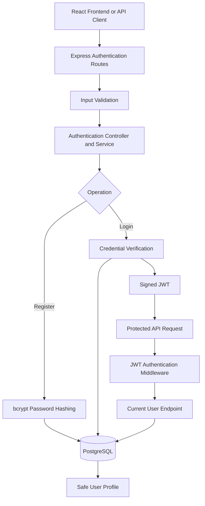

# Express API Backend

<p align="center">
  
</p>

<p align="center">
  <strong>A secure authentication foundation for the Project Management & Team Collaboration SaaS.</strong>
  <br />
  User registration · Password hashing · JWT authentication · Profile management
</p>

<p align="center">
  
  
  
  
  
</p>

## Overview

This module implements the authentication and database foundations of the **Project Management & Team Collaboration SaaS**.

It provides the API functionality required to register users, authenticate accounts, verify JWT-protected requests, and retrieve the current user's profile.

The backend uses Express.js for HTTP routing, PostgreSQL for persistent user records, bcrypt for password hashing, and JSON Web Tokens for authenticated requests.

The module is designed to support integration with other backend resources. Authentication establishes user identity; individual modules must enforce authorization for their own projects, tasks, teams, and other resources.

## Features

| Feature | Endpoint or component | Description |
|---|---|---|
| User registration | `POST /api/auth/register` | Validates input, normalizes email, hashes the password, and creates an account |
| User login | `POST /api/auth/login` | Verifies credentials and returns a signed JWT |
| Token verification | `authenticateToken` middleware | Verifies token signature and expiration |
| Current-user profile | `GET /api/auth/me` | Returns the authenticated user's safe profile |
| User persistence | PostgreSQL `users` table | Stores user records with case-insensitive email uniqueness |
| Automated testing | `npm test` | Tests the API using an isolated in-memory query stub |

### Security principles

- Passwords are stored as bcrypt hashes, not plaintext.
- Password hashes are excluded from API responses.
- JWT secrets and database credentials are provided through environment variables.
- Login failures use generic responses.
- A valid token proves identity, not permission to access every resource.
- Resource-level authorization remains the responsibility of each feature module.

Registration passwords must contain at least 8 characters and must not exceed 72 UTF-8 bytes.

## Architecture



## API reference

The default API base URL is `http://localhost:5000`. Endpoints use JSON.

### 1. Register an account

`POST /api/auth/register`

Request:

```json
{
  "name": "Example User",
  "email": "user@example.com",
  "password": "replace-with-a-secure-password"
}
```

Successful response — `201 Created`:

```json
{
  "success": true,
  "user": {
    "id": "1",
    "name": "Example User",
    "email": "user@example.com",
    "createdAt": "2026-01-01T12:00:00.000Z",
    "updatedAt": "2026-01-01T12:00:00.000Z"
  }
}
```

Expected error responses:

- `400 Bad Request` — Missing or invalid input.
- `409 Conflict` — Email address already registered.

Email addresses are trimmed and normalized to lowercase.

### 2. Log in

`POST /api/auth/login`

Request:

```json
{
  "email": "user@example.com",
  "password": "replace-with-a-secure-password"
}
```

Successful response — `200 OK`:

```json
{
  "success": true,
  "token": "<JWT_FROM_LOGIN>",
  "user": {
    "id": "1",
    "name": "Example User",
    "email": "user@example.com",
    "createdAt": "2026-01-01T12:00:00.000Z",
    "updatedAt": "2026-01-01T12:00:00.000Z"
  }
}
```

Invalid credentials return `401 Unauthorized` with a generic error message.

Token expiration is controlled by `JWT_EXPIRES_IN` and defaults to `1h`.

### 3. Retrieve the current user

`GET /api/auth/me`

Request header:

```http
Authorization: Bearer <JWT_FROM_LOGIN>
```

Returns the authenticated user's safe profile, including ID, name, email, and timestamps.

Possible errors:

- `401 Unauthorized` — Token missing, invalid, or expired.
- `404 Not Found` — The token refers to a user who no longer exists.

### 4. Protect another route

Reuse the authentication middleware in other backend modules:

```javascript
const authenticateToken = require("../middleware/authenticateToken");

router.get("/protected-route", authenticateToken, handler);
```

The middleware verifies the user's identity and attaches the verified user ID to `req.user.id`. The route must still enforce the appropriate resource-level permissions.

## Technology stack

<p align="center">
  
</p>

| Technology | Purpose |
|---|---|
| Node.js 18+ | JavaScript runtime |
| Express.js | REST API and routing |
| PostgreSQL | Persistent user storage |
| bcrypt | Password hashing and verification |
| jsonwebtoken | JWT signing and verification |
| Zod | Request validation |
| npm | Dependency management |

Check `backend/package.json` to confirm the installed dependency versions.

## Getting started

### Prerequisites

- Node.js 18 or newer
- npm
- PostgreSQL
- Git

### 1. Install dependencies

Open a terminal in the `backend/` directory:

```bash
npm install
```

### 2. Configure environment variables

In PowerShell, create a local environment file:

```powershell
Copy-Item .env.example .env
```

Configure the variables in `.env`. Depending on your setup, use either `DATABASE_URL` or the individual database settings:

```env
PORT=5000
NODE_ENV=development

DB_HOST=localhost
DB_PORT=5432
DB_NAME=project_management_saas
DB_USER=your_db_user
DB_PASSWORD=your_local_password

JWT_SECRET=replace-with-a-secure-random-secret
JWT_EXPIRES_IN=1h
```

Generate a secure JWT secret rather than using the example value. The application expects a secret of at least 32 bytes.

When using separate database settings, `DB_USER` is required; host, port, and database name have defaults.

**Never commit `.env` or real credentials to GitHub.**

### 3. Create the database and apply the migration

Create the PostgreSQL database if it does not already exist.

From the repository root, run the existing migration:

```bash
psql -U your_db_user -d project_management_saas -f database/migrations/001_create_users.sql
```

Replace `your_db_user` with your actual local database username.

The migration creates the users table and a case-insensitive unique email index. It uses `CREATE TABLE IF NOT EXISTS` and is intended not to reset existing data.

### 4. Start the development server

From `backend/`:

```bash
npm run dev
```

For a non-development start:

```bash
npm start
```

The default base URL is:

`http://localhost:5000`

## Testing

Run the automated API tests from `backend/`:

```bash
npm test
```

The test suite replaces the shared PostgreSQL query function with an isolated in-memory stub. It does not connect to PostgreSQL or use production data.

### Optional database connectivity check

The manual connectivity check is separate from the automated tests.

Configure `TEST_DATABASE_URL` to point to a dedicated test database whose name contains `test`, then run:

```bash
node src/config/testDb.js
```

Run this command only from `backend/`, and only after verifying the test database configuration. The check is designed to reject unsafe database targets and perform a read-only query. Never point it at a production database.

## Security checklist

- [ ] Store passwords only as bcrypt hashes.
- [ ] Keep database credentials and `JWT_SECRET` in environment variables.
- [ ] Exclude `.env` files and credentials from Git.
- [ ] Validate request input on the server.
- [ ] Use generic login errors.
- [ ] Verify JWT signatures and expiration on protected routes.
- [ ] Enforce project-, task-, and team-level authorization in the relevant modules.
- [ ] Never treat a valid JWT as unrestricted access to all resources.
- [ ] Use a dedicated test database for database connectivity checks.

## Integration with the frontend and other modules

The authentication API is intended to provide the identity foundation for the Project Management & Team Collaboration SaaS.

Other modules can reuse the authentication middleware when they need to identify a logged-in user. Each module must independently check whether that user has permission to access the requested project, task, team, or other resource.

Coordinate endpoint contracts and authentication requirements with the frontend and other backend contributors before integration.

## Development roadmap

Potential next improvements include:

- Expand automated authentication tests.
- Integrate authentication middleware with protected project and task routes.
- Implement resource-level authorization checks.
- Document additional API endpoints as they are implemented.
- Keep environment setup instructions aligned with the actual codebase.

## Project scope

This README documents the Express.js authentication and database-configuration module only. It does not describe every feature or contributor's work across the shared repository.

<p align="center">
  <sub>Project Management & Team Collaboration SaaS · Express.js · PostgreSQL · JWT</sub>
</p>
