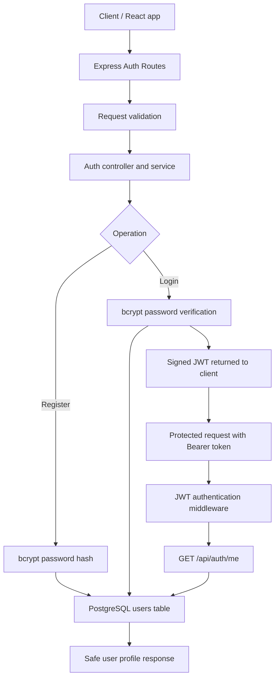

  

  <strong>Authentication and database foundations for the Project Management & Team Collaboration SaaS.</strong>
   
  A focused backend module for account registration, secure login, token-based authentication, and the current-user profile API.

  
  
  
  
  

  

📌 About this module
This directory contains the Express.js backend work for User Authentication and Security in the Project Management & Team Collaboration SaaS. It is intended to remain a focused module within the shared repository; it does not replace the repository's root README or describe every teammate's work.

The API uses PostgreSQL for user persistence, bcrypt for password hashing, and JSON Web Tokens (JWTs) for authenticated requests. It is designed so other backend routes can reuse the authentication middleware while implementing their own resource-level authorization.
✨ Authentication features
Capability	Endpoint / component	Purpose
Register an account	POST /api/auth/register	Validate details, normalize email, hash password, and create a user
Log in	POST /api/auth/login	Verify credentials and return a signed JWT
Verify authenticated requests	authenticateToken middleware	Validate bearer-token signature and expiry; attach the verified user ID to req.user.id
Get current user	GET /api/auth/me	Return the authenticated user's safe profile
Store users	PostgreSQL users table	Persist user data with a unique, case-insensitive email index
Test the authentication flow	npm test	Run API tests using an isolated in-memory query stub, without connecting to PostgreSQL

Response safety: Passwords and password hashes are not returned in API responses. Registration passwords must be at least 8 characters and no more than 72 UTF-8 bytes.
🧭 Request flow

🔌 API reference
The API listens on http://localhost:5000 by default. All endpoints use JSON.
POST /api/auth/register
Create a user account.

Request body
{
  "name": "Example User",
  "email": "user@example.com",
  "password": "replace-with-a-secure-password"
}
Success: 201 Created
{
  "success": true,
  "user": {
    "id": "1",
    "name": "Example User",
    "email": "user@example.com",
    "createdAt": "2026-01-01T12:00:00.000Z",
    "updatedAt": "2026-01-01T12:00:00.000Z"
  }
}
Emails are trimmed and normalized to lowercase. Invalid or missing fields return 400 Bad Request; an email already in use returns 409 Conflict.
POST /api/auth/login
Authenticate a registered user and receive a JWT.

Request body
{
  "email": "user@example.com",
  "password": "replace-with-a-secure-password"
}
Success: 200 OK
{
  "success": true,
  "token": "<JWT_FROM_LOGIN>",
  "user": {
    "id": "1",
    "name": "Example User",
    "email": "user@example.com",
    "createdAt": "2026-01-01T12:00:00.000Z",
    "updatedAt": "2026-01-01T12:00:00.000Z"
  }
}
Invalid credentials return a generic 401 Unauthorized response. Token expiration is configured by JWT_EXPIRES_IN and defaults to 1h.
GET /api/auth/me
Return the current authenticated user's safe profile.

Request header
Authorization: Bearer <token>
Success returns the user's id, name, email, createdAt, and updatedAt. Missing, invalid, or expired tokens return 401 Unauthorized. If the token refers to a user who no longer exists, the endpoint returns 404 Not Found.
Reuse the middleware
Other backend modules can protect a route with the reusable middleware. It verifies token identity, but it does not decide whether the user may access a particular project or task; each module must enforce its own resource-level authorization.
const authenticateToken = require("../middleware/authenticateToken");

router.get("/protected-route", authenticateToken, handler);
🧰 Tech stack

  
  
  
  
  
  
  

- Node.js 18 or newer and Express.js for the REST API.
- PostgreSQL for user persistence.
- bcrypt for secure password hashing and verification.
- jsonwebtoken for signing and verifying tokens.
- Zod for request validation.
- npm for dependency and script management.
These dependencies should match backend/package.json; check that file if anything differs.
⚙️ Local setup
Prerequisites
- Node.js 18 or newer
- npm
- PostgreSQL
1. Install dependencies
From the backend/ directory:
npm install
2. Create your local environment file
Copy-Item .env.example .env
Set local values in .env. Configure either DATABASE_URL or the separate DB_HOST, DB_PORT, DB_NAME, DB_USER, and DB_PASSWORD variables. Set JWT_SECRET to a securely generated random value of at least 32 bytes. JWT_EXPIRES_IN defaults to 1h; supported examples include 15m and 1d.

Never commit .env or put real credentials in documentation.
3. Apply the users migration
Create the PostgreSQL database if it does not already exist. Then run this command from the repository root, adjusting the database user and database name for your local setup:
psql -U your_db_user -d project_management_saas -f database/migrations/001_create_users.sql
The migration uses CREATE TABLE IF NOT EXISTS and a unique case-insensitive email index. It does not reset or delete existing data.
4. Start the API
From backend/:
npm run dev
For a non-development start:
npm start
The default base URL is http://localhost:5000.
🧪 Testing
From backend/, run:
npm test
The API tests replace the shared PostgreSQL pool query function with an isolated in-memory stub. They do not connect to PostgreSQL or use production data.
Manual database connectivity check
src/config/testDb.js is a separate manual check; it is not used by the automated test suite. It requires a dedicated TEST_DATABASE_URL and must not fall back to DATABASE_URL or application database settings.

Run it from backend/ only after configuring TEST_DATABASE_URL for a dedicated test database whose database name contains test:
node src/config/testDb.js
The check refuses missing configuration, production-identified database names or hosts, application-database targets, and production mode. It performs only a read-only SELECT and must not create, delete, truncate, or modify tables. Never point it at a production database.
🔐 Security notes
- Store passwords only as bcrypt hashes.
- Keep JWT_SECRET and database credentials in local environment variables.
- Do not commit .env, access tokens, passwords, or other secrets.
- Treat a valid JWT as proof of identity, not as proof of permission to access every resource.
- Enforce project-, task-, and team-level authorization in the relevant modules before exposing protected operations.
- Use generic login errors so responses do not reveal whether a particular email is registered.
🤝 Scope and collaboration
This README documents the Express.js authentication and database-configuration work in this backend directory. It is not a description of every module or every contributor's branch. Other team members can reuse the exported authentication middleware when integrating their routes, and must implement authorization for the resources they own.
🛣️ Next steps
- Extend authentication tests as new cases are added.
- Integrate authentication middleware with protected project and task routes after coordinating with their owners.
- Add resource-level authorization checks.
- Keep API examples and setup steps synchronized with the actual implementation.

  Built as part of the Project Management & Team Collaboration SaaS · Express.js · PostgreSQL

